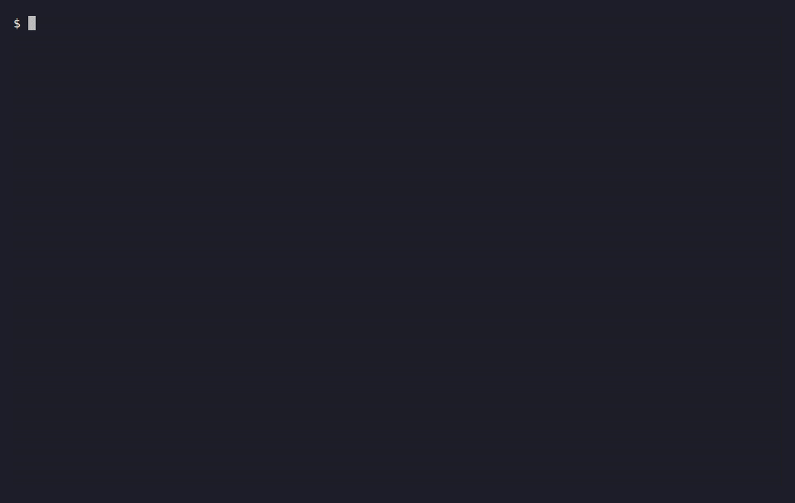

<div align="center">

# Aegis

**Roll back what your AI agent broke.**

[](CHANGELOG.md)
[](#install)
[](LICENSE)
[](Cargo.toml)

</div>

Aegis sits between an AI agent and your shell. Safe commands run at once.
Destructive ones, like `rm -rf` or `git reset --hard`, wait for your approval,
and Aegis saves your work first where it can. If the agent deletes the wrong
thing, one command brings it back.

Install the binary, then add the Claude Code plugin:

```bash
npm i -g @iliasalmerekov/aegis
```

```text
/plugin marketplace add IliasAlmerekov/aegis-shellguard
/plugin install aegis@aegis-shellguard
```



Claude Code and Codex share one policy and one Audit log (`~/.aegis/audit.jsonl`).
Other agents go through `$SHELL` on a best-effort basis.

---

## Why Aegis

AI agents move fast, and sometimes in the wrong direction. They delete files and
directories, rewrite git history, drop databases, and push things you did not
intend to push. Blocking everything makes the agent useless. Blocking too little
leaves you restoring from backups. Aegis does three things:

- It asks first. A destructive command pauses for your decision: approve, deny, or inspect.
- It takes a Snapshot before damage. Dangerous commands trigger best-effort Snapshots (git, Docker, databases) before they run, so `aegis rollback --last` can restore what they changed.
- It records everything. An append-only Audit log holds every command and every decision.

Aegis decides by heuristics, not by understanding your command. It is not a
privilege boundary: it does not stop code that already runs as you. See the
[threat model](docs/threat-model.md), and [how it works](docs/how-it-works.md)
for risk levels, effect opacity, and the Sandbox.

---

## Install

> [!IMPORTANT]
> **Windows:** install inside WSL2. Native PowerShell and `cmd.exe` are not supported, and there is no native Windows build.

### Claude Code plugin

The plugin is the primary install path for Claude Code. It registers the hooks
and a `/aegis:rollback` command without editing `settings.json`. It does not
ship the binary, so install `aegis` first with npm or Homebrew below.

```text
/plugin marketplace add IliasAlmerekov/aegis-shellguard
/plugin install aegis@aegis-shellguard
```

### npm

```bash
npm i -g @iliasalmerekov/aegis
```

Runs `aegis install-hooks --all` automatically when Claude Code or Codex config directories are present. Set `AEGIS_NPM_SKIP_HOOKS=1` to opt out. While the Claude Code plugin is enabled and installed, that step skips Claude Code, so its hooks run once.

npm and Cargo install the binary only; neither runs the global shell installer or edits your shell startup files. Opt in with `aegis setup-shell` (see below).

Update notices are opt-in and npm only:

```bash
aegis update enable --channel npm   # opt in
aegis update status                 # consent, cache, last check
aegis update check                  # check the registry right now
aegis update disable                # opt out
```

With this on, the shell proxy checks for a newer release at most once a day
and prints a one-line notice, only on an interactive terminal, never in
`aegis watch`, `--output json`, or an agent hook. Aegis never runs `npm`
itself. It only tells you the version and the exact command to run
(ADR-038).

### Homebrew

```bash
brew tap IliasAlmerekov/aegis
brew install aegis
```

Homebrew installs the binary only. Like npm and Cargo, it does not run the global shell installer. Opt in with `aegis setup-shell`.

### Quick install (recommended)

```bash
curl -fsSL https://raw.githubusercontent.com/IliasAlmerekov/aegis-shellguard/main/scripts/install.sh | sh
```

Installs the binary, writes a managed block to `~/.zshrc` or `~/.bashrc`, and hooks into Claude Code and Codex when those config directories already exist. Reload your shell afterwards.

### Developer source install

```bash
cargo install --git https://github.com/IliasAlmerekov/aegis-shellguard --tag v0.7.1 aegis
```

### Shell-proxy mode (package manager installs)

Package manager installs are binary-only. To opt in to shell-proxy mode:

```bash
aegis setup-shell
```

This adds a managed block to `~/.zshrc` or `~/.bashrc` that sets `SHELL` to the
aegis binary and `AEGIS_REAL_SHELL` to your real shell. Remove it with:

```bash
aegis setup-shell --remove
```

The convenience installer is Global-first: it installs the binary, writes the managed shell block, and sets up Claude Code and Codex hooks when those config directories already exist. The old Local project-only and Binary-only installer modes have been removed. Package-manager installs are binary-only.

### Verify it works

```bash
aegis --version                         # prints version number
aegis -c 'echo hello'                   # safe, runs immediately, no prompt
aegis -c 'rm -rf /tmp/aegis-test'       # danger, interceptor appears, press D to deny
```

> [!TIP]
> If `echo hello` runs right away and the risky command prompts, Aegis is working.

---

## Connect to your AI agent

Claude Code and Codex are protected through `PreToolUse` hooks, not shell-proxy tricks. These hooks intercept Bash commands regardless of `$SHELL`.

```bash
# Claude Code
aegis install-hooks --claude-code

# All supported agents at once
aegis install-hooks --all
```

Re-run after upgrading to refresh the managed hooks, including SessionStart
effective-state notices, the fail-closed panic layer (ADR-023), and to migrate
any older `aegis hook` / `aegis-rewrite.sh` registration to the current shim.
If `aegis off` is active, each new Claude Code or Codex session visibly reports
that commands use unguarded passthrough; `aegis on` re-enables enforcement. CI
keeps enforcement active even if the local disabled flag exists and reports that
override at session start.

> [!TIP]
> Other agents: for tools that respect `$SHELL`, run `aegis setup-shell`. For an agent with a `shell` config field, find the `shell` field and set it to the output of `command -v aegis`.

---

## Safety limits

These limits matter when you decide how far to trust Aegis. The full text is in
[how it works](docs/how-it-works.md).

- Effect-opaque execution, such as `sh ./cleanup.sh`, needs a Snapshot before it runs. If none is created, you see only "Run once without recovery" or "Deny". Aegis does not inspect the referenced script, and a Snapshot is not a complete backup.
- The Sandbox is a write/network guardrail. It is not a confidentiality boundary and not a privilege boundary.
- In Aegis 1.0 the Sandbox layer is mandatory ([ADR-029](docs/adr/adr-029-the-sandbox-is-a-mandatory-1-0-layer.md)). `sandbox.enabled` and `sandbox.required` stay accepted and ignored, each reported as a `deprecated_sandbox_field`.
- Current pre-1.0 implementation: the 0.x binary still records `sandbox_status = "unavailable"` and warns before running unconfined when confinement is missing.

---

## Uninstall

First remove Aegis-managed shell blocks and Claude Code/Codex hooks:

```bash
aegis uninstall
# Also delete ~/.aegis (audit logs, snapshots, toggle and update state):
aegis uninstall --purge-data
```

The command keeps data by default and prints its data decision. It preserves
`~/.config/aegis/config.toml` and unrelated hooks. It checks `~/.bashrc` and
`~/.zshrc`; for a custom startup file, pass `--rc-file /absolute/path/to/rc`.
If `$SHELL` still points at Aegis and neither file held a block, it warns you
to rerun with `--rc-file`.

The binary stays installed so uninstall can finish without a package-manager
subprocess. The command prints a removal channel inferred from the canonical binary path, so symlinks resolve. Check it, then remove the binary separately:

| Removal channel | Binary removal |
|----------------------|----------------|
| npm (global) | `npm uninstall -g @iliasalmerekov/aegis` |
| Homebrew | `brew uninstall aegis` |
| Cargo | `cargo uninstall aegis` (use `--root /install/root` for a custom root) |
| curl installer | `rm -- /path/to/aegis` using the printed binary path |

Path inference does not prove package ownership. If the channel is unknown,
check how you installed it and rerun with `--channel npm`, `homebrew`, `cargo`,
or `curl`. A project-local npm installation is not treated as a global install.
Open a new terminal after removal.

For older versions without `aegis uninstall`, this fallback removes only the
curl-installed binary at `${AEGIS_BINDIR:-/usr/local/bin}/aegis` and its setup:

```bash
curl -fsSL https://raw.githubusercontent.com/IliasAlmerekov/aegis-shellguard/main/scripts/uninstall.sh | sh
# Explicit data purge:
curl -fsSL https://raw.githubusercontent.com/IliasAlmerekov/aegis-shellguard/main/scripts/uninstall.sh | sh -s -- --purge-data
```

The fallback keeps data unless requested and warns if another binary remains on
PATH. It prints npm, Homebrew, or Cargo removal advice when detected; it never
runs their uninstall commands.

If you removed the package before running `aegis uninstall`, the binary is gone
but the hooks remain, so the hook shim denies every agent Bash command. Run the
curl fallback above to clean up. It needs `jq` when `~/.claude/settings.json` or
`~/.codex/hooks.json` exists. It only cleans the rc file chosen by `$SHELL` (or
`AEGIS_SHELL_RC`). On Intel macOS, `/usr/local/bin/aegis` may be a Homebrew link
into the Cellar; the script leaves it alone and tells you to run
`brew uninstall aegis`.

Neither path touches project-local hooks. Projects where you ran
`aegis install-hooks --local` keep their `./.claude/settings.json` entries and
`./.claude/hooks/` files, and need manual cleanup.

---

---

## Docs

| Document | Description |
|----------|-------------|
| [How it works](docs/how-it-works.md) | Risk levels, effect opacity, Required recovery, and the Sandbox |
| [Product requirements](PRD.md) | The normative Aegis 1.0 promise |
| [Architecture decisions](docs/adr/README.md) | The ADR index, every accepted decision |
| [Threat model](docs/threat-model.md) | Security scope and assumptions |
| [Config schema](docs/config-schema.md) | `aegis.toml` reference |
| [Platform support](docs/platform-support.md) | Linux, macOS, WSL2 details |
| [Release readiness](docs/release-readiness.md) | Recorded release-verification evidence |
| [Troubleshooting](docs/troubleshooting.md) | Install, hook, and integrity problems |
| [CI](docs/ci.md) | What the pipeline gates on |
| [Performance baseline](docs/performance-baseline.md) | Hot-path benchmark baselines |

What still blocks 1.0 is the
[`1.0` milestone](https://github.com/IliasAlmerekov/aegis-shellguard/milestone/1),
the only release gate.
